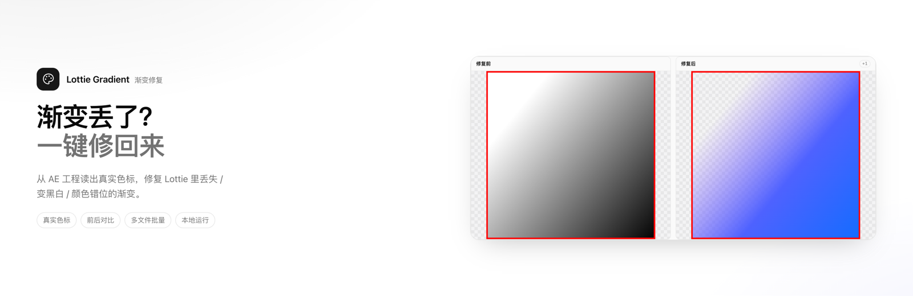
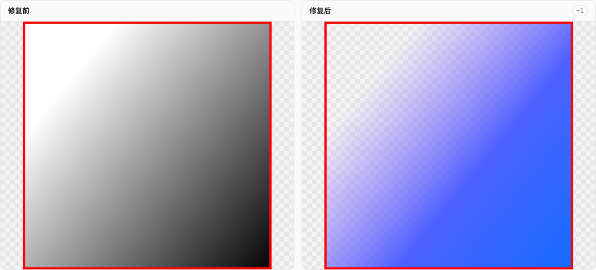
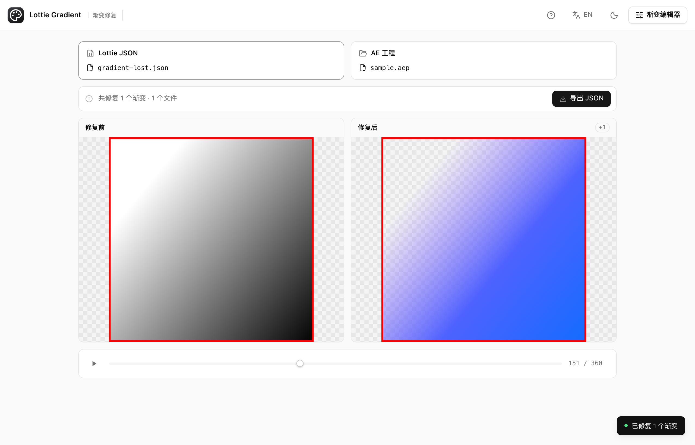
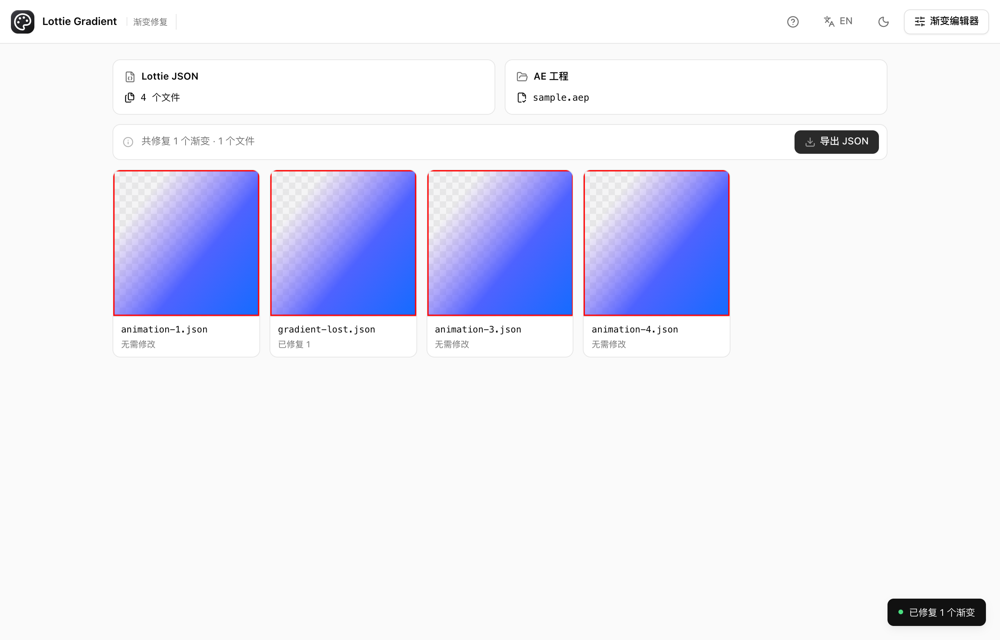
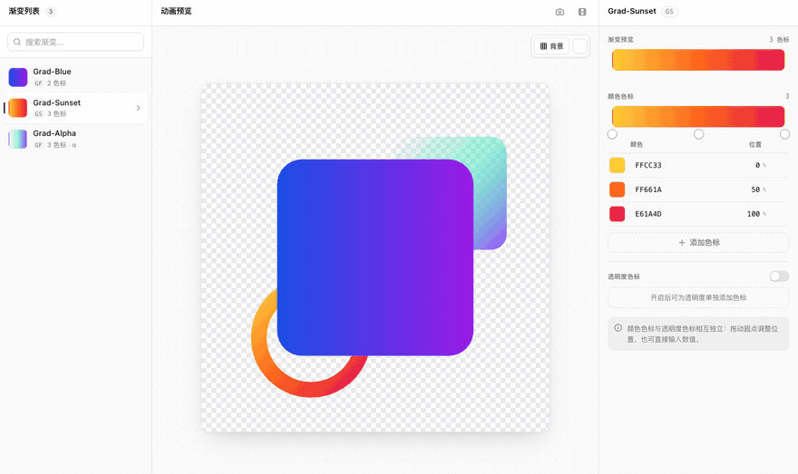
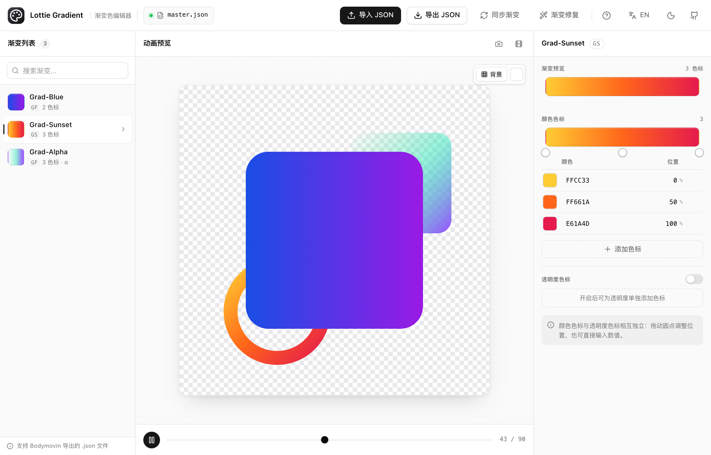

<p align="center">
  
</p>

<h1 align="center">Lottie Gradient · 渐变修复</h1>

<p align="center">
  <a href="https://www.lottie.uno"></a>
  <a href="https://www.lottie.uno/editor.html"></a>
  <a href="https://github.com/ArvinYin1/lottiegradient/actions/workflows/deploy.yml"></a>
  <a href="https://github.com/ArvinYin1/lottiegradient/stargazers"></a>
</p>

<p align="center">
  从 After Effects 工程读取真实渐变色标，一键修复 Lottie JSON 里 <b>丢失、变黑白、颜色错位</b> 的渐变。<br>
  <sub>Fix lost, black-and-white or shifted gradient colors in Lottie animations — using the real stops from your AE project.</sub>
</p>

---

## 效果



左边是 Bodymovin 导出的典型丢色结果（白 → 黑），右边是从 AE 工程读回真实色标并修复后的画面——颜色、位置和透明度一起恢复到工程里的样子。

## 怎么用

1. 拖入 **AE 工程（`.aep`）** 和 **一个或多个 Lottie JSON**
2. 点「解析并修复」（首次会加载约 15 MB 的浏览器内 Python 运行时，之后走缓存）
3. 看修复前 / 修复后对比，导出结果



一次选了多个 JSON 时，先给「结果总览」，点卡片再进单个文件的细节对比：



## 为什么能修准

| 关键点 | 说明 |
|---|---|
| 颜色为什么丢 | Bodymovin 的渐变是从 `.aep` 里**按名字文本搜索**刮出来的：工程没存盘、名字重复（`Gradient Fill 1` ×N）、非英文界面都会导致颜色丢失或串色 |
| 我们怎么取真值 | 浏览器里用 Pyodide 跑 [py-aep](https://github.com/forticheprod/py-aep)，**直接解析 `.aep` 的渐变 XML**，拿到每个色标的位置、颜色、透明度与中点 |
| 怎么对上号 | 按「合成 / 图层 / 组 / 渐变名」路径精确匹配，失败再退回「同名 + 出现顺序」 |
| 写回是否一致 | 复刻 Bodymovin 的中点展开规则（AE 的 N 个色标 → Lottie 的 2N−1 个），写回的值与 AE 逐位一致 |
| 隐私 | 工程和 JSON 都不会上传，解析全部在本机浏览器里完成 |

## 渐变编辑器（手动微调）

自动修复覆盖不到的场景（关键帧渐变、工程已丢失、只有 JSON 没有 `.aep`），用编辑器手动改：拖色标、改 HEX / 位置、单独增删透明度色标、从别的 JSON 同步渐变。





编辑器还支持：动画播放与逐帧预览、棋盘格 / 纯色背景切换、当前帧 PNG 与整段 GIF 导出。

## 技术栈

纯前端静态站点，**无构建步骤**：

| 技术 | 用途 | 来源 |
|------|------|------|
| HTML5 + Vanilla JS | 页面结构和逻辑 | 原生 |
| 手写 CSS 设计系统 | shadcn 风格 tokens + 深浅主题 | `css/style.css` |
| Lottie Web | 动画渲染 / 修复前后对比 | `js/vendor/lottie.min.js` |
| Pyodide + py-aep | 浏览器内解析 `.aep`，读取真实渐变色标 | `js/vendor/pyodide/`、`js/vendor/pyaep-libs.zip` |
| gif.js | GIF 导出 | `js/vendor/gif.js` |
| Lucide | 图标 | `js/vendor/lucide.min.js` |

> 运行时资源默认从 GitHub Pages（CDN）加载，失败自动回落同源 `js/vendor/`；加 `?local=1` 可强制同源（离线 / 内网场景）。

## 本地运行

```bash
git clone https://github.com/ArvinYin1/lottiegradient.git
cd lottiegradient

# 首页（渐变修复）要加载 wasm，必须走本地服务器
python3 -m http.server 8080
open http://localhost:8080/

# 渐变编辑器在 /editor.html
```

## 测试

两套真实浏览器测试（puppeteer-core + 系统 Chrome）：

```bash
cd tests
npm install          # 仅首次
npm test             # 编辑器：14 条
npm run test:backfill  # 首页渐变修复：52 条
npm run test:all       # 两套都跑
```

| 套件 | 覆盖 |
|---|---|
| `tests/smoke.mjs` | 编辑器：加载 / 导入 / 选中 / 改色 / 增删色标 / 搜索 / 播放 / 导出 / 响应式 / 同名渐变 / 色标分离 / 播放状态 / 关键帧 |
| `tests/backfill.mjs` | 首页：上传即预览 / 总览与细节 / 单一动作位 / 场景提示 / 加载态 / MIME 与 CDN 回退 / 自动修复 / 聚焦 / 中英切换 |

## 部署

纯静态站点，同时托管在 GitHub Pages 与自建 nginx：

- **GitHub Pages**：推送 `main` 后自动更新，备用地址 https://arvinyin1.github.io/lottiegradient/
- **自建服务器**：`deploy.sh` 用 rsync over SSH 同步到 nginx 目录，并验收线上 HTTP 状态

```bash
SSH_KEY=/path/to/key ./deploy.sh            # 同步 + 线上验收
SSH_KEY=/path/to/key ./deploy.sh --dry-run  # 只预览
```

推送 `main` 也会触发 `.github/workflows/deploy.yml` 自动部署（需要 `DEPLOY_SSH_KEY` 与 `DEPLOY_SSH_HOST_KEY` 两个 Secrets）。

> **nginx 建议**：前端已对 MIME 做兜底，配上这两行可启用 wasm 流式编译并省流量：
> ```nginx
> types { application/wasm wasm; }
> gzip on; gzip_types application/wasm application/javascript;
> ```

## English

- **Gradient Fix** (homepage) — load your After Effects project plus one or more Bodymovin JSON files; the tool reads the real gradient stops out of the `.aep` (via py-aep running in Pyodide), writes them back automatically, and plays a before/after comparison. Everything runs locally in the browser.
- **Gradient Editor** (`editor.html`) — manual editing: drag stops, change HEX / offsets, edit alpha stops independently, export JSON / PNG / GIF.
- No build step. Serve `index.html` over HTTP (wasm needs it); the editor also works from `file://`.

## 相关链接

- [Lottie 官方文档](https://airbnb.io/lottie/)
- [Bodymovin 插件](https://github.com/airbnb/lottie-web)
- [py-aep](https://github.com/forticheprod/py-aep)（`.aep` 解析）
- [使用演示 (Bilibili)](https://www.bilibili.com/video/BV1xcBRBREWL/)

---

MIT License © 2024
